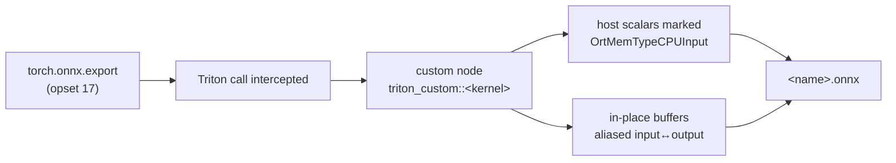
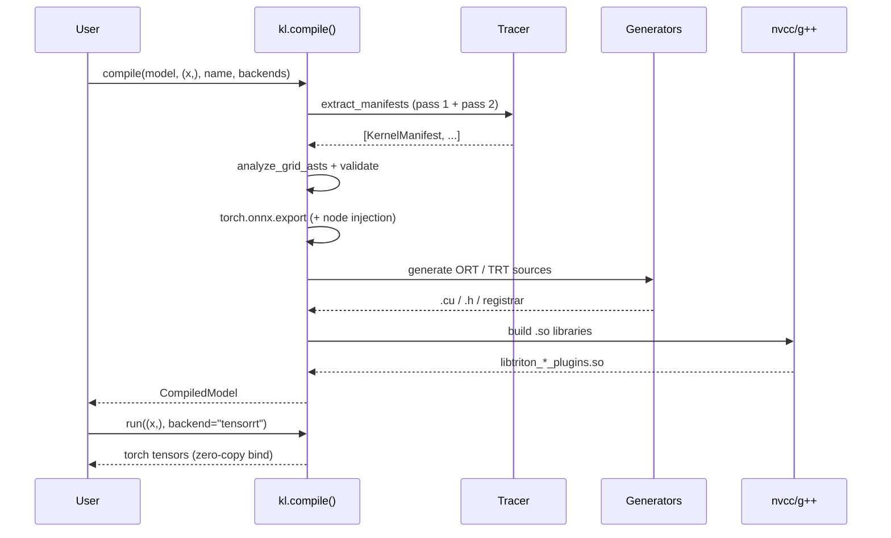

# Architecture

KernelLens converts a `torch.nn.Module` that launches custom `@triton.jit`
kernels into **native C++ artifacts** for ONNX Runtime and TensorRT. The whole
system is four compiler phases plus a runtime. This page describes what each
phase actually does, down to the files it writes and the ABI it reconstructs.


## The shape of the problem

A Triton kernel is *not* a single opaque operator. Its launch site encodes
seven distinct kinds of information, and each one has to reach C++ through a
different mechanism.


| Category | Meaning | How KernelLens carries it to C++ |
| :--- | :--- | :--- |
| `P_in` | read-only VRAM pointers | plugin inputs, bound by address |
| `P_out` | write-only VRAM pointers | plugin outputs, allocated by the engine |
| `P_inplace` | pointer both loaded and stored | input/output **aliasing** in the graph/plugin |
| `S` | element strides | `int64` runtime arguments |
| `D` | host scalars that change per call | `OrtMemTypeCPUInput` / plugin members |
| `C` | `tl.constexpr` values | baked into PTX, **removed** from the ABI |
| `G` | the launch grid (a Python expression) | transpiled to C++ integer math |

Two of these are the reason naive export tools fail. First, the compiled PTX
**re-orders and drops parameters** and fixes their bitwidths, so the host must
reconstruct the entry-slot ABI rather than assume the Python signature. Second,
the grid is an arbitrary Python lambda over runtime shapes; it cannot be frozen
at compile time.

## Phase 1 — Analysis & manifest assembly

Phase 1 runs the model **twice** and inspects the kernel source once.

=== "Pass 1 — eager PTX capture"

    The model executes normally on the GPU. KernelLens patches
    `triton.JITFunction.run` and, for each launch, reads the compiled kernel's
    PTX text, dynamic shared-memory size, `num_warps`, the concrete launch grid,
    and every argument's shape, strides and dtype.

    This is the only pass that can see the *real* compiled artifact, so it
    supplies the PTX and the concrete tensor metadata.

=== "Pass 2 — symbolic grid capture"

    The module is re-executed under `make_fx(..., tracing_mode="symbolic")` with
    fake tensors. The grid lambda now evaluates over `SymInt` sizes, and
    KernelLens stringifies those symbolic expressions so they can later be
    transpiled into C++.

    Pass 2 is *best effort*: if it raises or captures a different number of
    kernels than Pass 1, KernelLens falls back to the concrete Pass 1 manifests.
    This keeps compilation deterministic.

=== "Static AST scan"

    An `ast.NodeVisitor` walks the kernel source (recursively into Triton helper
    functions that are called) and records every `tl.load` / `tl.store` target.
    An argument that appears in both sets is classified `inplace`, one that is
    only stored is `output`, and the rest are `input`.

The product is a `KernelManifest`:

```python
@dataclass
class ArgumentDef:
    name: str
    kind: str          # input | output | inplace | scalar
    shape: tuple
    strides: tuple
    dtype: str
    value: Any = None  # for scalars
    is_constexpr: bool = False

@dataclass
class KernelManifest:
    kernel_name: str
    ptx: str
    shared_memory_bytes: int
    num_warps: int
    arguments: List[ArgumentDef]
    grid_cxx_exprs: List[str] = field(default_factory=list)
```

!!! note "`SymPy` was an overstatement"
    Earlier descriptions of KernelLens called this step *SymPy AST
    transpilation*. In reality the grid expression is a PyTorch `SymInt`
    (whose `.node.expr` happens to be a sympy object) and KernelLens transpiles
    it with **regular-expression substitution**, not a sympy visitor.
    `translate_symint_to_cxx()` rewrites `s0`, `s1`, ... into C++ shape lookups
    and turns `//` into `/`. There is no `sympy` dependency. The
    [verification page](verification.md) documents this correction.

## Phase 2 — ONNX graph rewrite

Phase 2 produces a normal ONNX graph that a stock ORT/TRT engine can consume.



A `TritonGlobalONNXExporter` hook runs during `torch.onnx.export`. When a Triton
kernel launches, the hook diverts the call into a custom-domain node carrying
the PTX payload, the shared-memory size and the argument taxonomy. Two details
matter for correctness:

- **Dynamic scalars** (e.g. a per-call `alpha`) are registered as **CPU inputs**
  (`OrtMemTypeCPUInput`) instead of static node attributes, so changing them
  does not force recompilation.
- **In-place buffers** are wired input-to-output, so downstream graph
  optimisations see the mutation instead of a spurious copy.

After export, a small graph-cleanup pass removes `Expand`/`Reshape` nodes that
would otherwise sit between the injected node and its consumers.

## Phase 3 — C++/CUDA code synthesis

Phase 3 writes real source files and compiles them. For each kernel it emits an
`OrtCustomOp` wrapper *and* a TensorRT `IPluginV2DynamicExt` + `IPluginCreator`,
plus a registrar, then invokes `nvcc` and `g++`.

Three problems dominate this phase.

**1. Reconstructing the PTX entry-slot ABI.** The generator parses
`.entry <kernel> (.param ...)` out of the PTX, determines each slot's C type
(`void*`, `int64_t`, `float`, `int32_t`) and textual parameter number, then maps
those slots back onto `input / output / inplace / scalar` arguments. The launch
argument array (`void*[]`) is rebuilt to match the PTX signature exactly.

**2. Evaluating the grid in C++.** `grid_cxx_exprs` from Phase 1 become C++
integer expressions over the *runtime* shapes (for ORT, the input tensor dims;
for TRT, `dim_values` / `getOutputDimensions`). This is what allows a single
compiled plugin to serve dynamic batch and sequence lengths without host-side
recompilation.

**3. Making the toolchain work off the vendor's happy path.** This is where most
of the engineering actually lives, and it is documented in detail on the
[verification page](verification.md). In short, KernelLens applies **PTX ISA
version clamping** (a Triton-generated `.version 9.3` is rewritten to `.version
9.0`, then `8.0`, so a CUDA driver JIT can load Blackwell-targeted PTX),
resolves **conda CUDA include layouts** (`<prefix>/targets/<triple>/include`
instead of `<prefix>/include`), and patches the known **glibc/nvcc
`math_functions.h` incompatibility** in whichever copy the compiler actually
reads.

The output is a self-contained shared library per backend:

```text
~/.kernel_lens_cache/<name>/
├── <name>.onnx
├── saved_args.pt
├── ort_plugins/
│   ├── <kernel>Op.cu  <kernel>Op.h
│   ├── register_ops.cpp
│   └── libtriton_ort_plugins.so
└── trt_plugins/
    ├── <kernel>Plugin.cu  <kernel>Plugin.h
    ├── register_plugins.cpp
    └── libtriton_trt_plugins.so
```

## Phase 4 — Zero-copy runtime

The runtime never stages tensor data through host memory. It hands PyTorch's
GPU addresses straight to the engine.


```text
T_prealloc ≈ O(1) pointer registration        +  T_kernel
T_staged   ≈ O(N) H2D copy + T_kernel + O(N) D2H copy     ← what we avoid
```

For ONNX Runtime, KernelLens builds an `IOBinding`, binds inputs and
pre-allocated outputs by CUDA device pointer, and calls
`run_with_iobinding`. For TensorRT it sets input shapes and registers every
tensor address with `set_tensor_address`, then `execute_async_v3` on the current
stream. `load(name)` reconstructs a `CompiledModel` from the cache without
recompiling, so a production cold start is a `dlopen` plus an engine
deserialisation.

## End-to-end control flow



## What is genuinely implemented

| Capability | Status |
| :--- | :--- |
| Dual-pass tracing (eager PTX + symbolic grid) | ✅ implemented, exercised |
| Static AST input/output/in-place classification | ✅ implemented |
| ONNX custom-node injection & CPU-scalar binding | ✅ implemented |
| `OrtCustomOp` and `IPluginV2DynamicExt` synthesis | ✅ implemented |
| PTX ISA version clamping for Blackwell | ✅ implemented |
| Dynamic grid → C++ integer evaluation | ✅ implemented |
| Zero-copy ORT `IOBinding` / TRT `set_tensor_address` | ✅ implemented |
| Cold-start disk caching of `.so` / `.engine` | ✅ implemented |
| **16-byte VRAM alignment guard with staging buffers** | ❌ **not implemented** — only a compile-time `inner_dim % 8 == 0` validation that raises |
| **SymPy-based grid transpilation** | ⚠️ regex over `SymInt` strings; no `sympy` |
| CUDA Graphs / cluster launch / auto-tune dispatch | 🗺️ planned (see [roadmap](roadmap.md)) |

The distinction between the last rows is deliberate and is what the
[verification page](verification.md) is for.